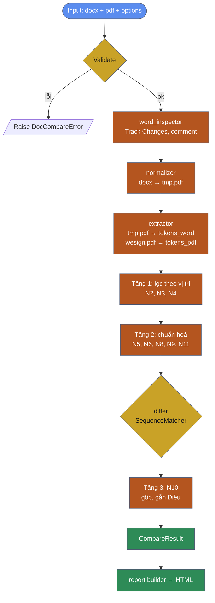

# SPEC – Contract Doc Compare (Word ↔ PDF)

> **Tài liệu bàn giao cho Coding Agent**
> Version: 1.0 · Date: 2026-10-12 · Owner/Reviewer: Khoa
> Trạng thái: ĐÃ DUYỆT kiến trúc. Bắt đầu từ Phase P1.

---

## 0. QUY TẮC LÀM VIỆC CHO AGENT (BẮT BUỘC)

1. **Làm từng phase theo thứ tự P1 → P6.** Không code trước phase sau.
2. **Hết mỗi phase phải DỪNG LẠI** và báo cáo cho reviewer theo mẫu ở mục 13. Chỉ làm phase tiếp theo khi reviewer trả lời "PASS – tiếp tục".
3. **Mọi acceptance criteria của phase phải pass bằng test tự động (`pytest`)**, không tính kiểm tra bằng mắt.
4. **Không tự mở rộng phạm vi.** Gặp tình huống spec không nói tới thì hỏi reviewer, không tự quyết.
5. **Không dùng AI hay LLM trong lõi xử lý.** Kết quả phải cố định: cùng input thì luôn ra cùng output.
6. **Nguyên tắc vàng khi lọc nhiễu:** *thà báo dư còn hơn bỏ sót*. Khi không chắc một chỗ khác có phải nhiễu hay không thì **giữ lại**, không lọc.
7. **Không bộ lọc nào được giấu ngầm.** Mọi token bị lọc đều phải được ghi lại (bộ lọc nào, nội dung gì, trang nào).
8. Code có type hint, docstring ngắn bằng tiếng Anh. Comment giải thích logic lọc nhiễu được viết bằng tiếng Việt.
9. Chạy offline 100%. Không gọi mạng, không telemetry.

---

## 1. Bối cảnh & mục tiêu

**Bối cảnh:** Hợp đồng ở dạng Word được sếp duyệt qua email. Sau đó user đưa file lên **WeSign** để ký, và trên WeSign nó thành PDF. Hiện Legal phải dò tay xem bản PDF có bị sửa gì so với bản Word đã duyệt hay không.

**Mục tiêu:** Một **tool desktop chạy độc lập**. Legal chọn 1 file Word và 1 file PDF, tool **liệt kê các điểm khác biệt về nội dung chữ, đã loại nhiễu**. Tool **không** đánh giá đúng sai; Legal tự quyết.

### 1.1 Trong phạm vi / Ngoài phạm vi

| Trong phạm vi | Ngoài phạm vi |
|---|---|
| So sánh nội dung chữ và số | Đánh giá hợp lệ hay vi phạm, duyệt, chặn ký |
| Lọc nhiễu do convert, dàn trang, WeSign | So sánh định dạng (font, màu, layout), hình ảnh |
| Tuỳ chọn phân biệt chữ hoa/thường (bật/tắt) | PDF scan (OCR) → chỉ phát hiện và báo lỗi |
| Cảnh báo Track Changes và comment trong Word | Xác minh chữ ký số có hợp lệ không |
| Hiển thị metadata PDF | Kéo thả file (chỉ dùng nút Chọn file) |
| Báo cáo HTML, in hoặc lưu được | Lưu trữ tập trung, đa người dùng, server |

---

## 2. Tech stack (đã chốt)

| Tầng | Công nghệ | Phiên bản gợi ý |
|---|---|---|
| Ngôn ngữ | Python | 3.11+ |
| UI | `customtkinter` | ≥ 5.2 |
| Word → PDF | LibreOffice headless (`soffice`) | ≥ 7.x, cài riêng trên máy |
| Đọc PDF | `pymupdf` (`fitz`) | ≥ 1.23 |
| Đọc Word (kiểm tra) | `python-docx` + `zipfile`/`lxml` để đọc XML | |
| So sánh | `difflib.SequenceMatcher` (thư viện chuẩn) | |
| Cấu hình | `pyyaml` | |
| Báo cáo | `jinja2` → HTML tĩnh, CSS nhúng sẵn, **không dùng CDN** | |
| Test | `pytest` | |
| Đóng gói | `pyinstaller` | |

Không thêm thư viện ngoài danh sách nếu chưa hỏi reviewer.

---

## 3. Cấu trúc thư mục

```
doc_compare/
├── app.py                      # entry point: python app.py → mở UI
├── cli.py                      # entry point CLI: python cli.py word.docx file.pdf [--case-sensitive] [-o out.html]
├── requirements.txt
├── README.md
├── config/
│   └── filters.yaml            # cấu hình bộ lọc (mục 7)
├── core/
│   ├── __init__.py
│   ├── models.py               # dataclass (mục 5)
│   ├── errors.py               # exception tuỳ biến (mục 10)
│   ├── soffice_locator.py      # dò đường dẫn soffice
│   ├── word_inspector.py       # Track Changes, comment
│   ├── normalizer.py           # Word → PDF tạm
│   ├── extractor.py            # PDF → Token (kèm bbox) + metadata
│   ├── noise_filters.py        # N2, N3, N4, N5, N6, N8, N9, N11
│   ├── differ.py               # diff + gộp + gắn Điều/khoản + N10
│   └── pipeline.py             # điều phối, trả CompareResult
├── report/
│   ├── builder.py
│   └── template.html.j2
├── ui/
│   └── main_window.py
├── tests/
│   ├── fixtures/
│   │   ├── sample_01/
│   │   │   ├── approved.docx
│   │   │   ├── wesign.pdf
│   │   │   └── expected.json
│   │   └── mutations/          # sinh tự động ở P2
│   ├── test_normalizer.py
│   ├── test_extractor.py
│   ├── test_noise_filters.py
│   ├── test_differ.py
│   ├── test_pipeline_sample01.py
│   └── test_mutations.py
└── logs/                       # file log khi chạy
```

---

## 4. Pipeline tổng quan



**Nguyên lý cốt lõi:** Không so trực tiếp Word với PDF. **Đổi Word sang PDF trước bằng LibreOffice, rồi so PDF với PDF.** Hai bên đi qua **cùng một hàm `extractor`**, nên nhiễu do khác định dạng file tự triệt tiêu.

---

## 5. Data models (`core/models.py`)

```python
from dataclasses import dataclass, field
from typing import Literal

Source = Literal["word", "pdf"]

@dataclass
class Token:
    raw: str                 # chữ gốc, dùng để HIỂN THỊ
    norm: str = ""           # chữ đã chuẩn hoá, dùng để SO (do tầng 2 điền)
    page: int = 0            # bắt đầu từ 1
    bbox: tuple[float, float, float, float] = (0, 0, 0, 0)
    block_no: int = 0
    line_no: int = 0
    source: Source = "pdf"

@dataclass
class FilteredToken:
    token: Token
    filter_id: str           # "N2", "N3", ...
    reason: str              # mô tả ngắn

@dataclass
class DiffItem:
    id: int
    kind: Literal["replace", "insert", "delete"]
    word_text: str           # nội dung bên Word (raw), rỗng nếu insert
    pdf_text: str            # nội dung bên PDF (raw), rỗng nếu delete
    context_before: str
    context_after: str
    clause: str              # vd "Điều 2.2", "Phần mở đầu"
    page_word: int | None
    page_pdf: int | None
    category: Literal["diff", "maybe_noise"] = "diff"
    note: str = ""           # vd "N10: nội dung giống nhau, chỉ khác vị trí"

@dataclass
class PdfMetadata:
    format: str
    producer: str
    creator: str
    author: str
    creation_date: str
    mod_date: str
    page_count: int
    signature_fields: int
    encrypted: bool

@dataclass
class WordInfo:
    tracked_insertions: int
    tracked_deletions: int
    comments: int

@dataclass
class CompareOptions:
    case_sensitive: bool = False          # mặc định TẮT
    config_path: str = "config/filters.yaml"

@dataclass
class CompareResult:
    word_path: str
    pdf_path: str
    word_sha256: str
    pdf_sha256: str
    options: CompareOptions
    tool_version: str
    run_at: str                            # ISO 8601, có múi giờ
    word_info: WordInfo
    pdf_meta: PdfMetadata
    diffs: list[DiffItem] = field(default_factory=list)
    filtered: list[FilteredToken] = field(default_factory=list)
    filter_stats: dict[str, int] = field(default_factory=dict)
    warnings: list[str] = field(default_factory=list)
```

---

## 6. Đặc tả từng module

### 6.1 `soffice_locator.py`

- `find_soffice() -> str`: tìm theo thứ tự sau:
  1. Biến môi trường `DOC_COMPARE_SOFFICE`
  2. `shutil.which("soffice")`
  3. Windows: `C:\Program Files\LibreOffice\program\soffice.exe`, `C:\Program Files (x86)\LibreOffice\program\soffice.exe`
  4. macOS: `/Applications/LibreOffice.app/Contents/MacOS/soffice`
- Không tìm thấy thì raise `LibreOfficeNotFoundError`.

### 6.2 `normalizer.py`

- `docx_to_pdf(docx_path: str, out_dir: str, timeout: int = 60) -> str`
- Lệnh chạy:
  ```
  soffice --headless --norestore --nolockcheck
          -env:UserInstallation=file:///<tmp_profile_dir>
          --convert-to pdf --outdir <out_dir> <docx_path>
  ```
  - **Bắt buộc** dùng `-env:UserInstallation` trỏ tới **thư mục profile tạm riêng cho mỗi lần chạy**. Nếu không, convert sẽ lỗi khi người dùng đang mở LibreOffice.
  - Copy docx ra thư mục tạm với tên ASCII ngắn (vd `input.docx`) trước khi convert, vì tên file gốc có dấu tiếng Việt, ngoặc vuông và khoảng trắng.
- **Comment không được in ra PDF** (mặc định của LibreOffice). Ở P1 phải viết test xác nhận nội dung comment không có trong PDF tạm.
- Quá `timeout` thì kill process và raise `ConvertTimeoutError`.
- Dọn thư mục tạm trong `finally`.
- Hỗ trợ cả `.doc` (LibreOffice convert được) nhưng thêm warning "Định dạng .doc cũ".

### 6.3 `word_inspector.py`

- `inspect_word(docx_path) -> WordInfo`
- Mở docx bằng `zipfile`, đọc `word/document.xml`:
  - `tracked_insertions` = số phần tử `w:ins`
  - `tracked_deletions` = số phần tử `w:del`
  - `comments` = số `w:commentReference`
- Nếu có `w:ins` hoặc `w:del` thì thêm warning: *"File Word còn {n} thay đổi chưa Accept/Reject (Track Changes). Tool so sánh theo bản hiển thị khi đã Accept tất cả."* Ở P1 phải viết test xác nhận LibreOffice export đúng như câu này; nếu không đúng thì báo reviewer.
- Nếu có comment thì thêm info: *"File Word có {n} comment (đã bỏ qua khi so sánh)."*

### 6.4 `extractor.py`

- `extract_tokens(pdf_path, source) -> tuple[list[Token], dict]`
- Dùng `page.get_text("words", sort=False)`, trả về `(x0, y0, x1, y1, word, block_no, line_no, word_no)`.
  - **Không dùng `sort=True`**, để giữ thứ tự đọc tự nhiên của file. Hai bên được xử lý cùng một cách.
- Trả thêm `page_info`: với mỗi trang gồm `{page_no, height, width, signature_rects: [...]}`.
  - `signature_rects` lấy từ `page.widgets()` với `field_type_string == "Signature"`.
- `extract_metadata(pdf_path) -> PdfMetadata`
- Kiểm tra:
  - `doc.is_encrypted` / `needs_pass` → raise `PdfEncryptedError`
  - Tổng số ký tự chữ trên mọi trang < 50 → raise `PdfNoTextError` ("có thể là PDF scan, không hỗ trợ")

### 6.5 `noise_filters.py`: xem **mục 7**

### 6.6 `differ.py`: xem **mục 8**

### 6.7 `pipeline.py`

```python
def run_compare(word_path: str, pdf_path: str, options: CompareOptions,
                progress_cb: Callable[[int, str], None] | None = None) -> CompareResult
```
- Thứ tự: validate → hash SHA-256 → inspect_word → docx_to_pdf → extract (2 bên) → tầng 1 → tầng 2 → diff → tầng 3 → build result.
- Gọi `progress_cb(percent, message_vi)` ở mỗi bước, để UI hiển thị tiến trình.
- Validate:
  - File tồn tại, đuôi file là `.docx`/`.doc` và `.pdf`
  - Kích thước ≤ 50MB mỗi file

---

## 7. ⭐ ĐẶC TẢ LỌC NHIỄU (QUAN TRỌNG NHẤT)

> **Nhiễu** là chỗ khác giữa hai file **do máy sinh ra** (convert, dàn trang, ký số), **không phải do người sửa nội dung**.

### 7.1 Tổng quan các tầng

| Tầng | Vị trí trong pipeline | Bộ lọc | Áp dụng cho |
|---|---|---|---|
| 0 | Trước khi đọc chữ | N0 (đánh số tự động), N1 (comment) | Tự động nhờ đổi Word sang PDF |
| 1 | Sau khi đọc chữ, **trước** chuẩn hoá | N2, N3, N4 | **Cả 2 bên** (N3 chỉ có tác dụng bên có ô chữ ký) |
| 2 | Trước diff | N5, N6, N8, N9, N11 | **Cả 2 bên, giống hệt nhau** |
| 3 | Sau diff | N10 | Kết quả diff |

**Bất biến:** mọi bộ lọc ở tầng 1 và 2 phải chạy **giống hệt nhau cho cả hai bên**. Không được có bộ lọc chỉ chạy một bên, trừ khi dữ liệu đầu vào khác nhau (vd: ô chữ ký chỉ có bên PDF).

### 7.2 Bảng đặc tả từng bộ lọc

#### N0 – Đánh số tự động (tầng 0)
- **Vấn đề:** Word lưu "5.1." dưới dạng list numbering, không lưu thành chữ. PDF thì có chữ "5.1.".
- **Cách xử lý:** Convert Word sang PDF bằng LibreOffice. Số được dàn trang thành chữ ở cả hai bên.
- **Không cần code riêng.** Test: PDF tạm từ Word phải chứa token "5.1." ở Điều 5.

#### N1 – Comment Word (tầng 0)
- **Cách xử lý:** LibreOffice không in comment.
- **Test:** chuỗi "Em đề xuất bổ sung nội dung này" **không** có trong tokens_word.

#### N2 – Số trang (tầng 1)
- **Quy tắc:** Bỏ một **dòng** (gom theo `block_no` + `line_no`) khi **cả 3 điều kiện** đều đúng:
  1. Dòng chỉ gồm **đúng 1 token**
  2. Token khớp regex `^\d{1,3}$`, hoặc là dạng "Trang N", "Page N", "N/M", "N of M" (regex trong config)
  3. Giá trị N **bằng đúng số trang hiện tại** (1-based) **hoặc** bằng số trang có offset cố định nhất quán trên toàn file (bỏ qua offset ở bản đầu, chỉ dùng = số trang)
- **Không** lọc theo dải vị trí trên/dưới trang (xem 7.4).
- Ghi `FilteredToken(filter_id="N2", reason="Số trang")`.

#### N3 – Vùng chữ ký số (tầng 1)
- **Quy tắc:** Với mỗi `signature_rect` của trang, mở rộng mỗi cạnh `signature_margin_pt` (mặc định **10pt**). Bỏ mọi token có **tâm bbox** nằm trong vùng mở rộng.
- Ví dụ thực tế (sample_01, trang 13): 2 ô Signature tại `[119,158,235,222]` và `[378,158,495,222]`. Các chữ cần bị lọc: "Digitally signed by: RAGHAV RAMAN SONI Date: 08/10/2026, 18:01:13", "Thời gian ký: 08/10/2026, 17:01:02".
- **Bổ sung (nếu sau khi lọc theo rect vẫn sót):** regex dự phòng trong config: `^Digitally signed by`, `^Thời gian ký:`, `^Date: \d{2}/\d{2}/\d{4}`. Regex này **chỉ được áp dụng cho token nằm trên trang có ô chữ ký**, không áp dụng cho các trang khác.
- Ghi `FilteredToken(filter_id="N3", ...)` → báo cáo hiển thị đầy đủ ở phụ lục.

#### N4 – Header/footer lặp lại (tầng 1)
- **Quy tắc:** Gom chữ theo dòng. Một dòng là header/footer khi:
  1. Cùng nội dung (sau khi chuẩn hoá khoảng trắng), **và**
  2. Toạ độ `y0` lệch ≤ 5pt giữa các lần xuất hiện, **và**
  3. Xuất hiện trên **≥ 60%** số trang của file đó (và file có ≥ 3 trang)
- Chạy riêng cho từng bên (mỗi file tự tính header/footer của nó).
- sample_01 không có header/footer → N4 phải lọc **0** token. Viết test để xác nhận.

#### N5 – Unicode tiếng Việt (tầng 2)
- **Quy tắc:**
  1. `unicodedata.normalize("NFC", s)`
  2. **Ghép dấu bị tách:** nếu một token chỉ gồm các ký tự combining (category `Mn`), hoặc bắt đầu bằng ký tự combining, thì ghép vào token liền trước rồi chạy lại NFC.
  3. Ví dụ phải pass: `"đê xuâ t"` → `"đề xuất"`; `"gô m"` → `"gồm"`.
- **Lưu ý:** lỗi này chủ yếu xuất hiện khi đọc chữ trực tiếp từ docx. Với cách đổi Word sang PDF thì có thể không gặp, nhưng **vẫn phải cài** vì an toàn.

#### N6 – Khoảng trắng & ngắt dòng (tầng 2)
- Gộp mọi whitespace (bao gồm `\t`, `\n`, NBSP `\u00a0`, `\u2009`, `\u200b`) → token hoá lại theo whitespace.
- **Ghép từ bị ngắt dòng có gạch nối:** khi token kết thúc bằng `-`, token kế tiếp **nằm ở dòng mới** và bắt đầu bằng chữ thường, thì ghép lại và bỏ `-`. **Không** áp dụng khi token chỉ có đúng `-` (dấu đầu dòng).

#### N8 – Ký tự tương đương (tầng 2)
- Bảng thay thế **cố định**, đặt trong `filters.yaml`:

| Từ | Thành |
|---|---|
| `“` `”` `„` `″` | `"` |
| `‘` `’` `′` | `'` |
| `–` `—` `−` | `-` |
| `…` | `...` |
| `•` `●` `▪` `◦` `` | `-` |
| `\u00a0` (NBSP) | ` ` |
| `fi` `fl` (ligature) | `fi` `fl` |

- **Cấm** thay thế chữ cái hay chữ số. Bảng này chỉ dành cho dấu câu và ký tự trình bày.

#### N9 – Chữ hoa/thường (tầng 2, **có tuỳ chọn**)
- `options.case_sensitive == False` (**mặc định**): `norm = norm.casefold()`.
- `options.case_sensitive == True`: giữ nguyên hoa/thường.
- Hiển thị luôn dùng `raw`.
- Báo cáo phải ghi rõ chế độ đang dùng: "Phân biệt hoa/thường: BẬT/TẮT".

#### N10 – Lệch thứ tự đọc (tầng 3, **không giấu**)
- **Vấn đề:** LibreOffice và Aspose (WeSign dùng) dàn trang khác nhau, nên thứ tự các block có thể bị đảo.
- **Quy tắc sau diff:**
  1. Lấy mọi diff `delete` (chỉ có ở Word) và `insert` (chỉ có ở PDF).
  2. Nếu một đoạn `delete` có `norm` **giống hệt** một đoạn `insert` (so cả chuỗi, độ dài ≥ 1 token) thì đánh dấu **cả hai** là `category="maybe_noise"`, `note="N10: Nội dung giống nhau, chỉ khác vị trí đọc"`.
  3. Khớp 1–1, mỗi đoạn chỉ được ghép một lần.
- **Không xoá**, chỉ chuyển sang nhóm 🟡 "Có thể là nhiễu".

#### N11 – Token rỗng (tầng 2)
- Sau N5, N6, N8, bỏ token có `norm == ""` hoặc chỉ gồm ký tự zero-width.

### 7.3 Ngăn chặn lọc nhầm (BẮT BUỘC)

| Rủi ro | Biện pháp |
|---|---|
| Lọc mất nội dung thật nằm sát mép trang | **Cấm lọc theo dải vị trí.** N2 và N4 dùng điều kiện nội dung, không chỉ dùng vị trí |
| N3 lọc mất chữ thật cạnh ô chữ ký | Chỉ lọc chữ có **tâm bbox** nằm trong ô; margin cấu hình được; ghi lại đầy đủ |
| N8 vô tình đổi nghĩa | Bảng cố định, chỉ có ký tự dấu câu; có unit test kiểm tra không có chữ cái hay chữ số trong bảng |
| Bộ lọc giấu thay đổi thật | **Test ngược ở P2** phải pass 100% |

### 7.4 Bài học đã biết (KHÔNG lặp lại)

Bản thử nghiệm đầu tiên lọc header/footer bằng cách bỏ mọi chữ ở **6% trên và 8% dưới mỗi trang**. Kết quả là lọc nhầm nội dung thật:
- "budgeting." nằm ở cuối trang 2 (bản LibreOffice) → bị cắt
- "Sửa đổi:" nằm ở cuối trang 7 (bản WeSign) → bị cắt

→ Sinh ra 2 diff sai. **Tuyệt đối không dùng cách lọc theo dải vị trí.**

### 7.5 `config/filters.yaml` (mẫu)

```yaml
version: 1
filters:
  N2_page_number:
    enabled: true
    patterns:
      - '^\d{1,3}$'
      - '^(Trang|Page)\s*\d{1,3}$'
      - '^\d{1,3}\s*/\s*\d{1,3}$'
      - '^\d{1,3}\s+of\s+\d{1,3}$'
  N3_signature:
    enabled: true
    margin_pt: 10
    fallback_patterns:
      - '^Digitally signed by'
      - '^Thời gian ký:'
      - '^Date:\s*\d{2}/\d{2}/\d{4}'
  N4_header_footer:
    enabled: true
    min_page_ratio: 0.6
    min_pages: 3
    y_tolerance_pt: 5
  N5_unicode: { enabled: true }
  N6_whitespace: { enabled: true, join_hyphenated: true }
  N8_char_map:
    enabled: true
    map:
      "“": '"'
      "”": '"'
      "„": '"'
      "‘": "'"
      "’": "'"
      "–": "-"
      "—": "-"
      "−": "-"
      "…": "..."
      "•": "-"
      "●": "-"
      "▪": "-"
      "\u00a0": " "
  N10_reorder: { enabled: true }
  N11_empty: { enabled: true }
diff:
  merge_gap_tokens: 2
  context_tokens: 6
```

Tắt một bộ lọc (`enabled: false`) thì token tương ứng sẽ đi vào diff bình thường. Dùng cách này để debug.

---

## 8. Diff Engine (`differ.py`)

1. Input: `list[Token]` của 2 bên (đã qua tầng 1, 2). So trên `norm`.
2. `SequenceMatcher(None, a_norm, b_norm, autojunk=False)`. **Bắt buộc `autojunk=False`**, nếu không các từ lặp nhiều như "Bên", "Hợp đồng" sẽ bị bỏ qua khi so.
3. Bỏ op `equal`. Mỗi op `replace/insert/delete` thành 1 diff thô.
4. **Gộp:** hai diff thô liền nhau cách nhau ≤ `merge_gap_tokens` token `equal` thì gộp thành 1 `DiffItem` (các token equal ở giữa được đưa vào cả 2 bên để hiển thị liền mạch).
5. **Ngữ cảnh:** `context_tokens` token trước và sau, lấy từ phía Word (dùng `raw`).
6. **Gắn Điều/khoản (`clause`):** với vị trí bắt đầu của diff bên Word, dò ngược trong tokens_word để tìm:
   - Mục gần nhất khớp `^\d+\.\d+\.?$` (vd "2.2", "5.1.") → `"Điều 2.2"`
   - Nếu không có, lấy "ĐIỀU" + số gần nhất → `"Điều 2"`
   - Nếu chưa gặp "ĐIỀU" nào → `"Phần mở đầu"`
   - Nếu diff thuộc loại `insert` (chỉ có bên PDF) thì dò ngược bên PDF theo cùng quy tắc.
7. `page_word` / `page_pdf` = trang của token đầu tiên ở mỗi bên.
8. Chạy N10.
9. Đánh `id` tăng dần theo thứ tự xuất hiện trong văn bản.

---

## 9. Báo cáo HTML

### 9.1 Yêu cầu chung
- **1 file HTML duy nhất**, CSS nhúng sẵn, không dùng JS bên ngoài, không CDN. Chỉ dùng JS nhúng để thu gọn/mở rộng các phần.
- Font hệ thống, hiển thị đúng tiếng Việt (`<meta charset="utf-8">`).
- Có CSS `@media print`: khi in thì mở hết các phần thu gọn, không cắt ngang hàng của bảng.
- Tên file: `DocCompare_{yyyyMMdd_HHmmss}_{tên-file-pdf-rút-gọn}.html`, lưu cạnh file PDF hoặc vào thư mục người dùng chọn. Mặc định lưu vào `~/Documents/DocCompare/`.

### 9.2 Bố cục

1. **Tiêu đề:** "Báo cáo so sánh hợp đồng Word ↔ PDF"
2. **Thông tin chạy:** tên 2 file, **SHA-256** của 2 file, thời gian chạy, phiên bản tool, chế độ hoa/thường, danh sách bộ lọc đang bật.
3. **Tóm tắt** (to, rõ):
   - 🔴 **X điểm khác biệt**
   - 🟡 Y điểm có thể là nhiễu
   - ⚪ Z token đã lọc
   - Nếu X = 0 và Y = 0: "✅ Không tìm thấy khác biệt về nội dung chữ."
4. **Cảnh báo:** Track Changes, comment, `.doc`.
5. **Metadata PDF:** bảng gồm Producer, Creator, Author, ngày tạo, ngày sửa, số trang, số ô chữ ký. Kèm ghi chú: *"Metadata chỉ để tham khảo, có thể bị chỉnh sửa."*
6. **Bảng khác biệt chính** (🔴): cột `#`, `Điều/khoản`, `Bản Word (đã duyệt)`, `Bản PDF (WeSign)`, `Ngữ cảnh`, `Trang W/P`.
   - Chữ bị xoá (chỉ có ở Word): nền đỏ nhạt, gạch ngang.
   - Chữ được thêm (chỉ có ở PDF): nền xanh nhạt, gạch chân.
   - Trong diff `replace`, phải **tô ở mức ký tự** phần thực sự khác (vd `0`**`1`** → `0`**`8`**). Dùng `SequenceMatcher` thêm một lần ở mức ký tự.
7. **Bảng "Có thể là nhiễu"** (🟡): cùng cấu trúc, thêm cột `Ghi chú`; mặc định thu gọn.
8. **Phụ lục "Đã lọc"** (⚪): thống kê theo bộ lọc; mở rộng ra thì xem danh sách token (bộ lọc, trang, bên, nội dung); mặc định thu gọn.
9. **Footer:** *"Tool chỉ hỗ trợ chỉ ra khác biệt về nội dung chữ. Không so sánh định dạng và hình ảnh. Quyết định cuối cùng thuộc về Legal."*

---

## 10. Xử lý lỗi

| Exception | Khi nào | Thông báo hiển thị (tiếng Việt) |
|---|---|---|
| `InputFileError` | File không tồn tại, sai đuôi, > 50MB | "File không hợp lệ: {chi tiết}" |
| `LibreOfficeNotFoundError` | Không tìm thấy `soffice` | "Chưa cài LibreOffice. Vui lòng liên hệ IT hoặc cài tại libreoffice.org" |
| `ConvertTimeoutError` | Convert > 60s | "Chuyển đổi Word quá thời gian. Thử đóng các ứng dụng Office và chạy lại." |
| `ConvertFailedError` | soffice trả mã lỗi hoặc không ra file | "Không chuyển được file Word sang PDF." |
| `PdfEncryptedError` | PDF có mật khẩu | "PDF đang được khoá bằng mật khẩu, không thể đọc." |
| `PdfNoTextError` | Không có chữ | "PDF không có lớp chữ (có thể là bản scan). Tool không hỗ trợ." |
| `Exception` khác | | "Lỗi không xác định. Đã ghi log tại {path}." |

- Tất cả kế thừa `DocCompareError(message_vi: str)`.
- Log ghi vào `logs/doccompare_{date}.log` (bao gồm stack trace). **Không ghi nội dung hợp đồng vào log**, chỉ ghi tên file và hash.

---

## 11. UI (`ui/main_window.py`, CustomTkinter)

### 11.1 Layout (1 cửa sổ, khoảng 640×480, không đổi kích thước được)

```
┌──────────────────────────────────────────────────┐
│  So sánh hợp đồng Word ↔ PDF                     │
├──────────────────────────────────────────────────┤
│  File Word (đã duyệt):  [______________] [Chọn…] │
│  File PDF (WeSign):     [______________] [Chọn…] │
│                                                  │
│  [ ] Phân biệt chữ hoa/thường                    │
│                                                  │
│              [   So sánh   ]                     │
│  [████████████░░░░░░░░] 60% Đang đọc nội dung…   │
├──────────────────────────────────────────────────┤
│  Kết quả:                                        │
│  🔴 4 điểm khác biệt                              │
│  🟡 0 có thể là nhiễu   ⚪ 3 đã lọc               │
│  ⚠️ (cảnh báo nếu có)                            │
│                                                  │
│  [ Mở báo cáo chi tiết ]   [ Mở thư mục ]        │
└──────────────────────────────────────────────────┘
```

### 11.2 Hành vi
- Nút **Chọn…** dùng `filedialog.askopenfilename`, có filter `*.docx;*.doc` và `*.pdf`. Ô đường dẫn chỉ đọc, hiển thị tên file (hover thì hiện tooltip đường dẫn đầy đủ).
- Nút **So sánh** chỉ bật khi đã chọn đủ 2 file.
- Checkbox **Phân biệt chữ hoa/thường**: mặc định **bỏ chọn**, truyền vào `CompareOptions.case_sensitive`.
- Khi chạy:
  - Tắt tất cả các nút, hiện thanh tiến trình.
  - Gọi `run_compare` trong **`threading.Thread(daemon=True)`**.
  - Mọi cập nhật UI từ thread phải qua **`self.after(0, ...)`**. Không được động vào widget trực tiếp từ thread.
- Xong thì hiện tóm tắt, bật nút **Mở báo cáo chi tiết** (`webbrowser.open(file_uri)`) và **Mở thư mục** (`os.startfile` trên Windows / `open` trên macOS).
- Lỗi thì hiện `messagebox.showerror` với `message_vi`, rồi bật lại các nút.
- Theme: `customtkinter.set_appearance_mode("system")`, màu `"blue"`.

---

## 12. Đóng gói (P6)

- PyInstaller `--onedir` (khởi động nhanh hơn `--onefile`), `--windowed`.
- `--add-data` thư mục theme của customtkinter (`<site-packages>/customtkinter;customtkinter/`).
- `--add-data "config/filters.yaml;config"`, `--add-data "report/template.html.j2;report"`.
- Đọc resource qua helper `resource_path()` (xử lý trường hợp có `sys._MEIPASS`).
- **LibreOffice KHÔNG đóng gói chung.** Trong README ghi rõ yêu cầu máy phải cài LibreOffice.
- Mục tiêu: Windows 10/11 64-bit.

---

## 13. PHASES & ACCEPTANCE CRITERIA

> Hết mỗi phase, agent dừng lại và gửi báo cáo theo **mẫu ở 13.7**.

### P1 – Lõi xử lý + CLI
**Làm:** `models`, `errors`, `soffice_locator`, `word_inspector`, `normalizer`, `extractor`, `noise_filters` (N2–N11), `differ`, `pipeline`, `cli.py` (chỉ in kết quả ra console dạng bảng + xuất JSON với `--json`).

**Fixture:** `tests/fixtures/sample_01/`
- `approved.docx` = "0810 rev_[aDigit x FES]_FES - Mê Kông CF - Plan Launching_Contract.docx"
- `wesign.pdf` = "MK_Bao.Ha_0022_0810 rev_[aDigit x FES]_FES - Mê Kông CF - Plan Launching_Contract.pdf"

**`expected.json` (sample_01, case_sensitive = false):**
```json
{
  "diff_count": 4,
  "diffs": [
    {"clause": "Phần mở đầu", "word_contains": "01", "pdf_contains": "08", "context_contains": "tháng 10 năm 2026"},
    {"clause": "Phần mở đầu", "word_contains": "01st", "pdf_contains": "08th", "context_contains": "Oct 2026"},
    {"clause": "Điều 2.2",    "word_contains": "01/10/2026", "pdf_contains": "08/10/2026"},
    {"clause": "Điều 2.2",    "word_contains": "01st", "pdf_contains": "08th", "context_contains": "October 2026"}
  ],
  "maybe_noise_max": 2,
  "word_info": {"comments": 2},
  "pdf_meta": {"page_count": 13, "signature_fields": 2, "format": "PDF 1.7"},
  "filtered_must_include": [
    {"filter": "N3", "text_contains": "Digitally signed by"},
    {"filter": "N3", "text_contains": "Thời gian ký"}
  ],
  "word_tokens_must_not_include": ["Em đề xuất bổ sung nội dung này"]
}
```
> Lưu ý về tokenization: token "01/10/2026" có thể bị tách thành "01", "/", "10"... tuỳ cách tách từ. Test so khớp theo kiểu **chuỗi con (contains)**, không so khớp tuyệt đối từng token.

**Acceptance:**
- [ ] `pytest tests/test_pipeline_sample01.py` pass: **đúng 4 diff** loại 🔴, không có diff nào khác ngoài 4 diff trên.
- [ ] 🟡 ≤ 2. Nếu > 0 thì liệt kê lý do trong báo cáo phase.
- [ ] Unit test cho **từng** bộ lọc N2–N11, mỗi bộ lọc có ít nhất 1 test "phải lọc" và 1 test "không được lọc".
- [ ] Test N5: `"đê xuâ t"` → `"đề xuất"`, `"gô m"` → `"gồm"`.
- [ ] Test N9: bật `case_sensitive` thì "SONI" và "Soni" ra diff; tắt thì không ra.
- [ ] Test N8: bảng thay thế không có chữ cái hay chữ số nào.
- [ ] Không có dòng code nào lọc theo dải vị trí trên/dưới trang.
- [ ] Chạy 2 lần liên tiếp ra JSON giống hệt nhau (trừ `run_at`).

### P2 – Test ngược (Mutation test): CHỨNG MINH KHÔNG LỌC NHẦM
**Làm:** script `tests/make_mutations.py` tạo các bản đột biến từ `approved.docx` (sửa bằng `python-docx`), rồi convert sang PDF bằng LibreOffice để làm "PDF giả WeSign". So sánh `approved.docx` với từng bản đột biến.

| Mã | Đột biến | Mong đợi |
|---|---|---|
| M1 | Đổi 1 chữ số: "8%" → "9%" (Điều 4.6) | 1 diff, Điều 4.6 |
| M2 | Đổi số tiền: "500.000VNĐ" → "800.000VNĐ" | 1 diff, Điều 4.2 |
| M3 | Xoá cả câu "Bên B phải chịu các chi phí phát sinh liên quan đến việc chuyển khoản lại." | 1 diff `delete` |
| M4 | Thêm câu mới vào cuối Điều 7.2 | 1 diff `insert` |
| M5 | Đổi "Youtube" → "Tiktok" | 1 diff, Điều 2.1 |
| M6 | Đổi 1 chữ ở **dòng cuối cùng của một trang** | 1 diff (chứng minh không lọc theo vị trí) |
| M7 | Đổi 1 chữ ở **dòng đầu tiên của một trang** | 1 diff |
| M8 | Đổi "SONI" → "Soni" | `case_sensitive=true`: 1 diff · `false`: 0 diff |
| M9 | Đổi số tài khoản "612345688" → "612345699" | 1 diff |
| M10 | Đổi dấu: "Bình Hòa" → "Bình Hoà" | Ghi nhận kết quả, báo reviewer (NFC có thể coi là khác) |
| M11 | Đổi một số đứng riêng thành một dòng (vd số "3" trong danh sách) | Không bị N2 lọc nhầm nếu số đó ≠ số trang |
| M12 | Không đổi gì (bản đối chứng) | 0 diff |

**Acceptance:**
- [ ] M1–M9, M11, M12 pass **100%**.
- [ ] M10: báo kết quả cho reviewer.
- [ ] Mỗi mutation **phát hiện đúng chỗ** (Điều/khoản đúng).

### P3 – Báo cáo HTML
**Làm:** `report/builder.py`, `template.html.j2`, cờ CLI `-o out.html`.

**Acceptance:**
- [ ] sample_01 ra HTML đúng bố cục mục 9.2.
- [ ] Tô ở mức ký tự: `01` → `08` chỉ tô `1` và `8`.
- [ ] Mở offline được (tắt mạng vẫn hiển thị đầy đủ).
- [ ] Ctrl+P: tự mở các phần thu gọn, không vỡ bảng, tiếng Việt hiển thị đúng.
- [ ] Hiển thị SHA-256 của 2 file khớp với `sha256sum`.

### P4 – Kiểm chứng trên dữ liệu thật
**Làm:** reviewer cung cấp thêm 5–10 cặp Word/PDF thật. Agent chạy, lập bảng kết quả từng cặp: số diff 🔴/🟡, liệt kê **mọi** diff, kèm nhận định của agent "thật / nghi nhiễu".

**Acceptance:**
- [ ] Nhiễu lọt vào 🔴 ≤ 2 mỗi cặp. Nếu nhiều hơn thì đề xuất bổ sung bộ lọc, **chờ duyệt rồi mới code**.
- [ ] Bỏ sót = 0 (reviewer kiểm tra).
- [ ] Riêng phần **bảng biểu** (phụ lục ngân sách) phải báo kết quả riêng.

### P5 – UI CustomTkinter
**Làm:** `ui/main_window.py`, `app.py` theo mục 11.

**Acceptance:**
- [ ] Chạy sample_01 từ UI ra kết quả giống CLI.
- [ ] UI không bị đơ (không "Not Responding") trong lúc convert.
- [ ] Checkbox hoa/thường hoạt động (thử với M8).
- [ ] Từng lỗi ở mục 10 hiển thị đúng thông báo (giả lập: đổi tên soffice, PDF có mật khẩu, PDF scan).

### P6 – Đóng gói
**Acceptance:**
- [ ] Build `--onedir` chạy được trên một máy Windows sạch (đã cài LibreOffice, chưa cài Python).
- [ ] README: cách cài, cách dùng, yêu cầu hệ thống, cách sửa `filters.yaml`.

### 13.7 Mẫu báo cáo cuối phase

```markdown
## Phase Pn – Báo cáo
**Trạng thái:** DONE / BLOCKED
**Đã làm:** …
**Kết quả test:** (dán output pytest tóm tắt)
**Acceptance:** (checklist, tick từng mục)
**Vấn đề / quyết định cần reviewer:** …
**File thay đổi:** …
**Đề xuất phase tiếp theo:** …
```

---

## 14. Rủi ro đã biết

| # | Rủi ro | Hướng xử lý |
|---|---|---|
| R1 | LibreOffice dàn trang khác Aspose.Words (WeSign dùng) → lệch thứ tự đọc | N10. Nếu P4 ra quá nhiều 🟡 thì báo reviewer cân nhắc Aspose.Words (trả phí) |
| R2 | Bảng biểu có thứ tự đọc phức tạp | Theo dõi riêng ở P4 |
| R3 | Font nhúng thiếu ToUnicode → đọc ra ký tự lạ | Phát hiện ký tự `\ufffd`; có thì thêm warning |
| R4 | PyMuPDF là AGPL | Chỉ dùng nội bộ. Không phân phối ra ngoài |
| R5 | LibreOffice export Track Changes khác kỳ vọng | Kiểm chứng ở P1 (mục 6.3) |

---

## 15. Thông tin tham khảo về file mẫu (sample_01)

- PDF: PDF 1.7, 13 trang, có chữ thật trên mọi trang, không mã hoá.
- Producer: `Aspose.Words for .NET 23.2.0; modified using iText® Core 7.2.5 (AGPL version)` ×2 → WeSign convert bằng Aspose, ký 2 lần bằng iText.
- 2 ô Signature ở trang 13: `[119,158,235,222]`, `[378,158,495,222]`.
- Word có 2 comment (của Tran Thi Thuy Vy), không xác định có Track Changes hay không, cần kiểm tra ở P1.
- Khác biệt thật đã biết: 4 điểm về ngày (01 → 08), xem `expected.json`.
